# Compte rendu TP PetitPanier - CARELLE

Systèmes utilisés : Windows, Docker Desktop

## Palier 1

1.1 : Le Client est la commande docker que je tape, elle envoie des ordres. Le Server est le moteur Docker qui tourne en arrière-plan et qui construit les images et lance les conteneurs. Si le bloc Server est absent, le client ne peut pas joindre le moteur : Docker Desktop n'est pas démarré.

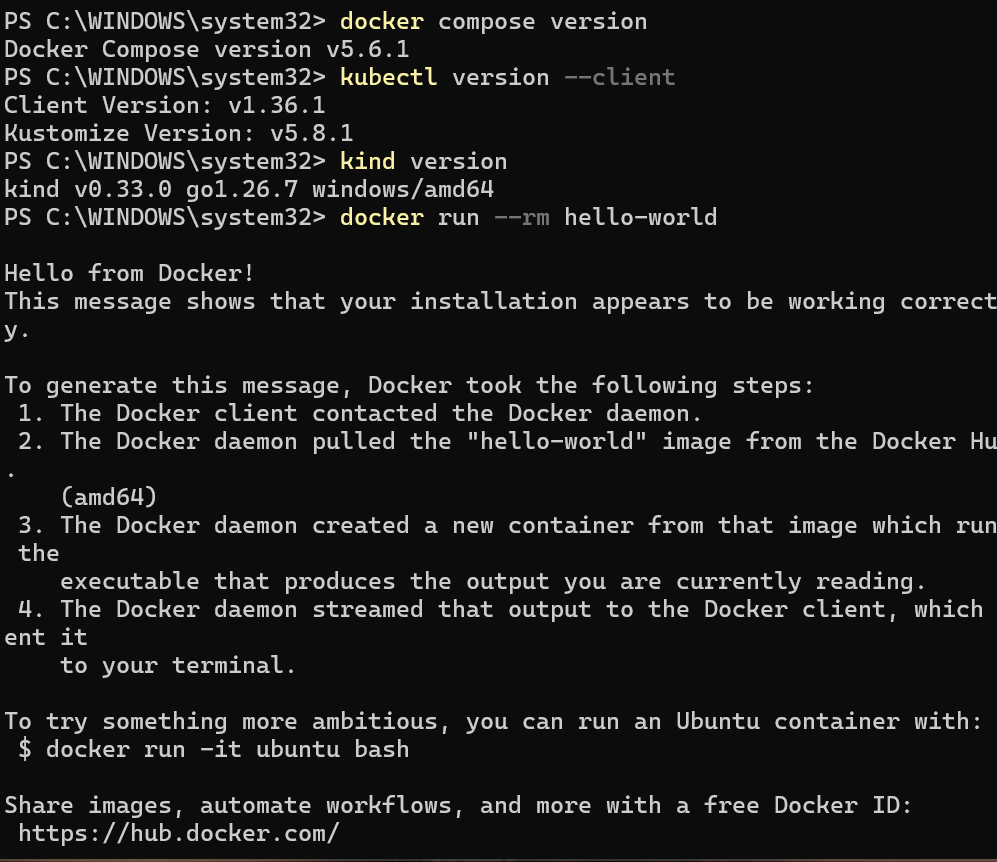

1.2 : Dans -p 8080:80, 8080 est le port de ma machine (celui que j'utilise dans le navigateur) et 80 est le port du conteneur (celui sur lequel nginx écoute). Docker redirige le port 8080 de ma machine vers le port 80 du conteneur.

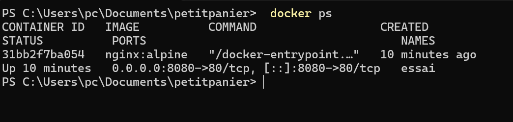

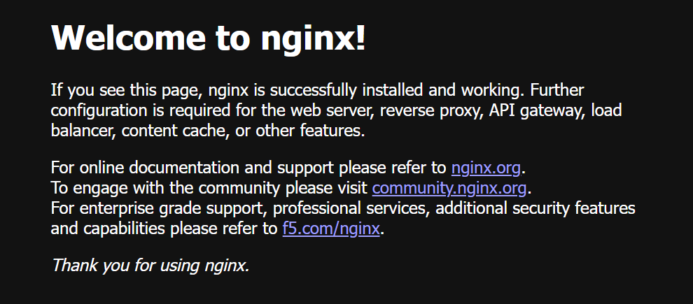

1.3 : Une image est un modèle en lecture seule, stocké sur mon PC, qui contient tout ce qu'il faut pour lancer un programme (ici nginx). Un conteneur est une instance de cette image en cours d'exécution : il est créé à partir de l'image, il a un nom, des logs et on peut entrer dedans. Après docker rm, le conteneur essai a disparu de docker ps -a, mais l'image nginx:alpine est toujours là dans docker image ls. On peut donc créer autant de conteneurs qu'on veut à partir d'une même image, et supprimer un conteneur ne supprime pas l'image.

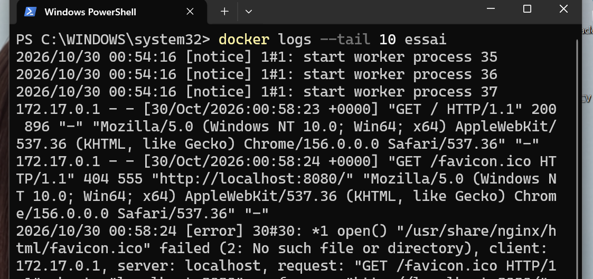

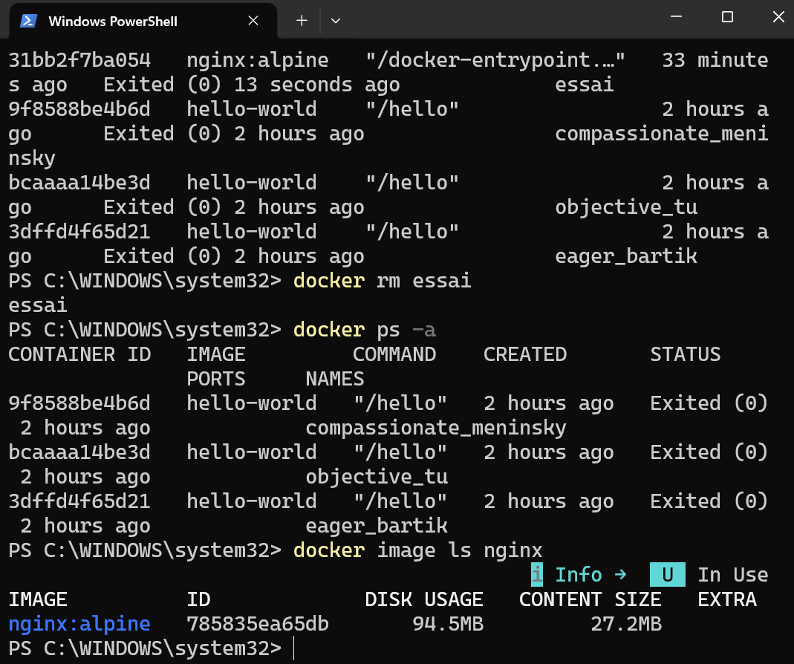

## Palier 2

2.1 : Page index.html créée.

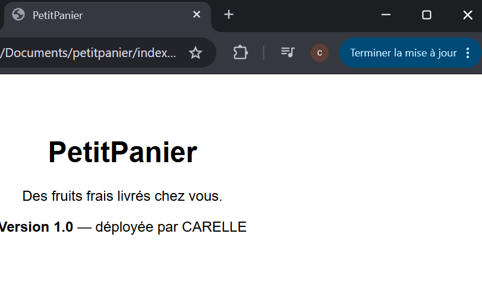

2.2 : Non, EXPOSE 8080 ne suffit pas. Cette instruction sert seulement à documenter le port sur lequel l'application écoute dans le conteneur, elle ne le rend pas accessible depuis ma machine. Pour ouvrir la page dans le navigateur, il faut publier le port avec -p au lancement du conteneur (par exemple -p 8080:8080), ce qui relie un port de ma machine au port du conteneur.

2.3 : Le . à la fin de docker build indique le contexte de build : c'est le dossier courant, que Docker utilise pour trouver le Dockerfile et les fichiers à copier dans l'image (comme index.html). Ici on utilise -p 8080:8080 parce que l'image nginx-unprivileged écoute sur le port 8080 dans le conteneur, alors que l'image nginx du palier 1 écoutait sur le port 80. Le port à droite de -p doit toujours être celui sur lequel l'application écoute dans le conteneur.

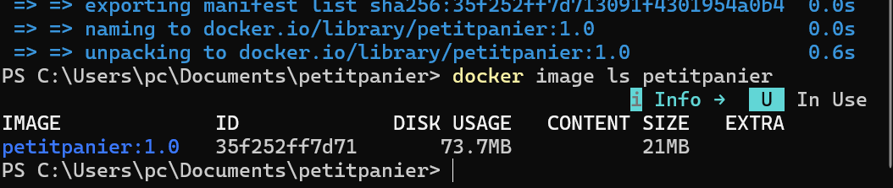

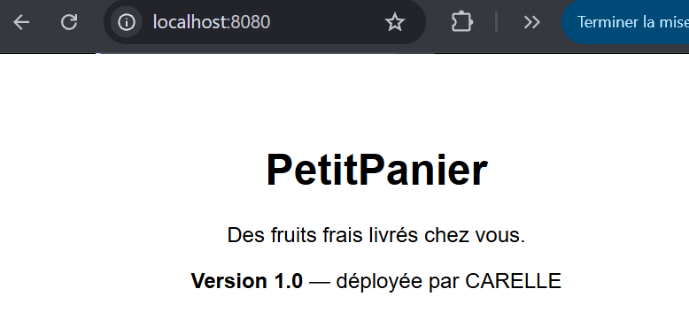

2.4 : La page affichait encore la 1.0 parce que le conteneur qui tournait avait été créé à partir de l'image 1.0. Construire une nouvelle image 2.0 ne modifie pas un conteneur déjà lancé : l'image est un modèle, le conteneur en est une copie qui ne change pas. Pour passer à la 2.0, j'ai utilisé docker rm -f petitpanier pour supprimer l'ancien conteneur, puis docker run --name petitpanier -d -p 8080:8080 petitpanier:2.0 pour en lancer un nouveau avec l'image 2.0.

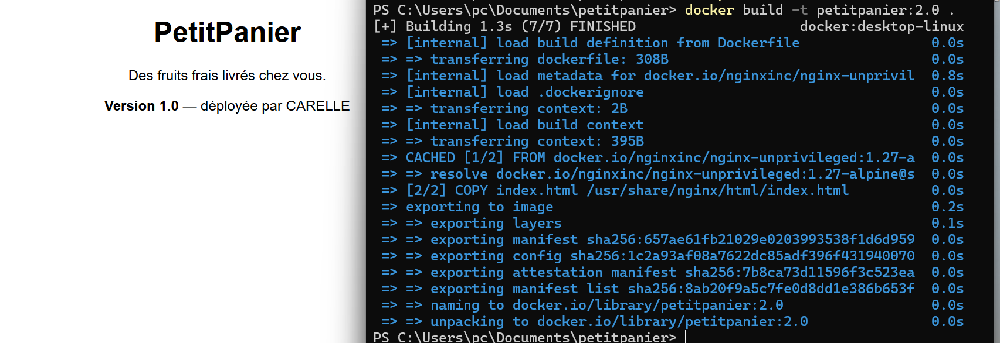

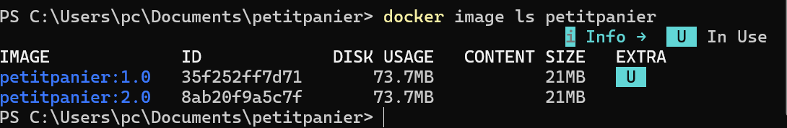

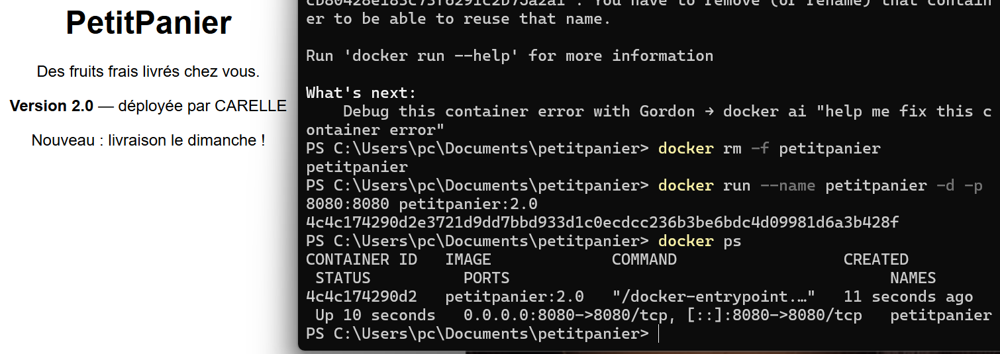

## Palier 3

3.1 : compose.yaml validé avec docker compose config.

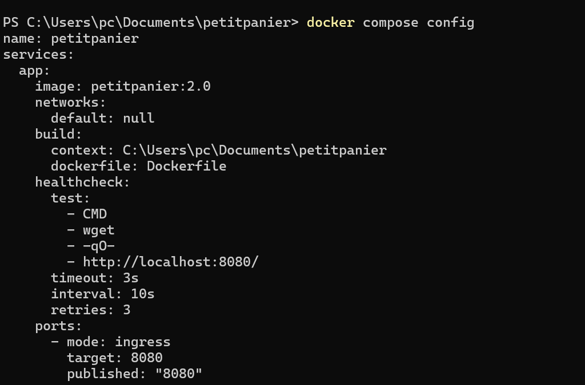

3.2 : Up signifie que le conteneur est démarré (le processus tourne). Up (healthy) signifie en plus que le test de santé réussit : l'application répond vraiment. Cette différence vient du bloc healthcheck du compose.yaml (la ligne test avec wget, exécutée toutes les 10 secondes). Mon service est passé à Up (healthy) avec le test sur http://127.0.0.1:8080/.

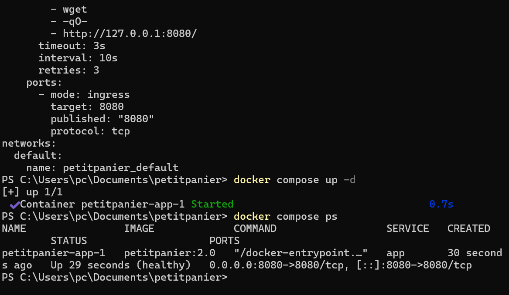

3.3 : La seconde commande échoue parce que localhost désigne toujours le conteneur lui-même. Dans le conteneur busybox, localhost est donc busybox, et personne n'y écoute sur le port 8080 : d'où Connection refused. Le site tourne dans un autre conteneur. app est le nom du service défini dans compose.yaml : Compose le déclare dans le réseau petitpanier\_default, et les conteneurs de ce réseau peuvent se joindre par ce nom, que Docker traduit en adresse IP du bon conteneur.

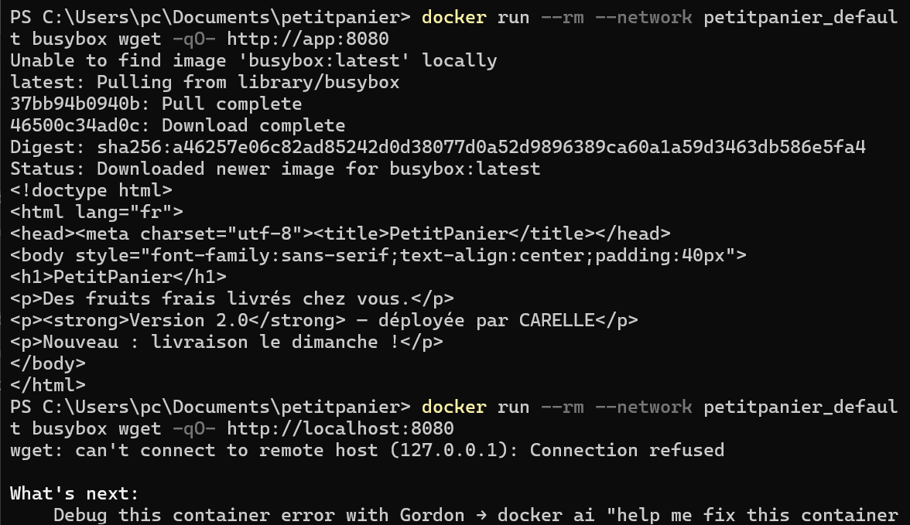

## Palier 4

4.1 : Le cluster kind tourne dans un conteneur Docker : ses nœuds ont leur propre stockage d'images, séparé de celui de ma machine. Mes images petitpanier:1.0 et 2.0 existent sur mon PC mais pas à l'intérieur du nœud, donc Kubernetes ne peut pas les trouver. kind load les copie dans le nœud. En entreprise, on publie les images dans un registre (Docker Hub, GitLab Container Registry, un registre privé du cloud...) et le cluster les télécharge depuis ce registre.

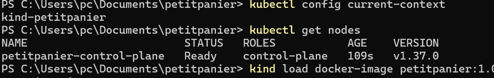

4.2 : Les labels app: petitpanier sont des étiquettes placées sur les Pods par le Deployment. Le Service utilise son selector pour retrouver les Pods qui portent cette étiquette et leur envoyer le trafic. Si le selector du Service était différent, il ne trouverait aucun Pod : les Pods seraient Running mais le Service n'aurait aucun endpoint, et le site ne serait pas accessible.

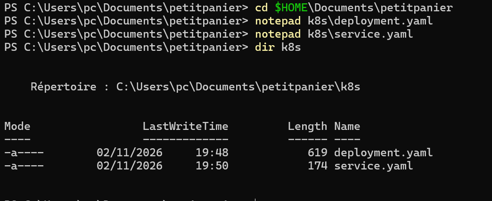

4.3 : L'adresse dans ENDPOINTS (10.244.0.5:8080) est l'adresse IP interne du Pod petitpanier dans le cluster, avec le port sur lequel le conteneur écoute. Le Service l'a trouvée grâce à son selector et lui envoie le trafic. Le Service est de type ClusterIP : il n'est joignable que depuis l'intérieur du cluster, et le cluster kind tourne dans un conteneur Docker, hors de portée de mon navigateur. port-forward crée un tunnel temporaire entre un port de ma machine (8080) et le Service, ce qui me permet d'ouvrir le site avec http://localhost:8080.

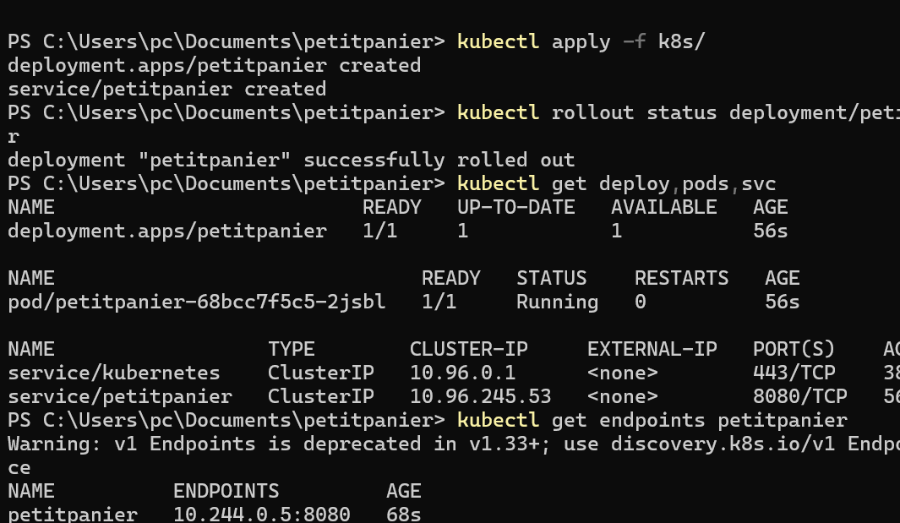

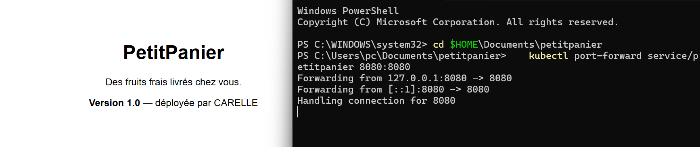

## Palier 5

5.1 : Non, mes 3 Pods tournent tous sur le même nœud, petitpanier-control-plane, car mon cluster kind n'a qu'un seul nœud. On ne peut donc pas parler de vraie haute disponibilité : si ce nœud tombe en panne, les 3 Pods tombent en même temps et le site est coupé. Les 3 réplicas protègent contre la panne d'un Pod (Kubernetes en recrée un), mais pas contre la panne d'une machine. Pour une vraie haute disponibilité, il faudrait plusieurs nœuds et répartir les Pods entre eux.

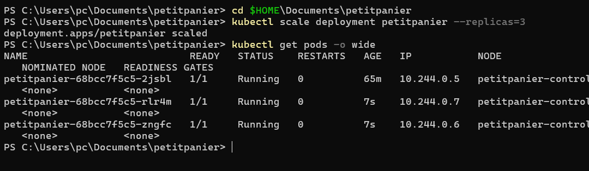

5.2 : C'est le Deployment (plus précisément son ReplicaSet) qui a recréé le Pod. Dans mon deployment, l'état désiré est replicas: 3. Quand j'ai supprimé un Pod, l'état réel est passé à 2 Pods, ce qui ne correspond plus à l'état désiré. Kubernetes compare en permanence l'état réel à l'état désiré et corrige l'écart : il a créé un nouveau Pod (xkshg) pour revenir à 3, sans que j'intervienne.

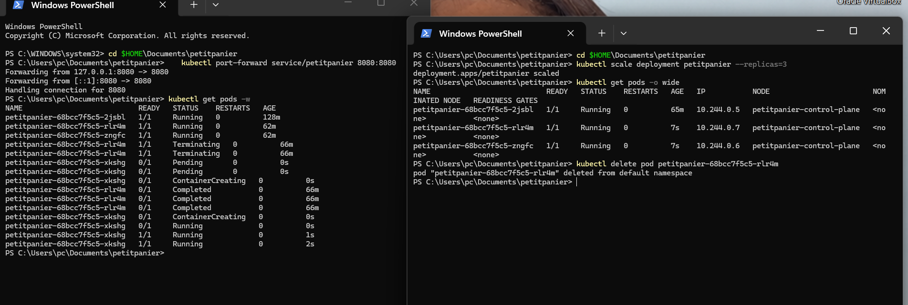

5.3 : Dans kubectl set image deployment/petitpanier web=petitpanier:2.0, web est le nom du conteneur dans le Pod, défini par la ligne "- name: web" de mon deployment.yaml. Il indique quel conteneur du Pod doit changer d'image (ici passer à petitpanier:2.0). rollout history affiche 2 révisions : la révision 1 (image 1.0) et la révision 2 (image 2.0).

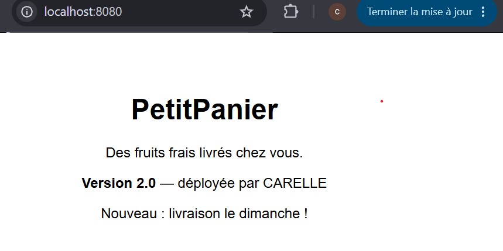

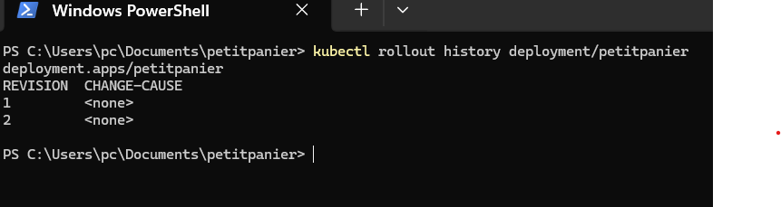

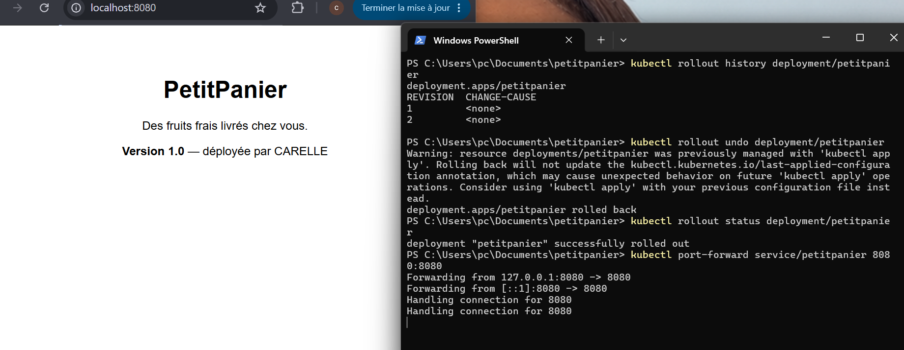

## Palier 6 - tableau de diagnostic

| Panne | Symptôme | Hypothèse | Commande de preuve et résultat | Correction |
|---|---|---|---|---|
| promo-1 | ImagePullBackOff (0/1) | Le tag de l'image est faux, l'image n'existe pas | kubectl describe pod : "Failed to pull image petitpanier:1.O ... repository does not exist" ; docker image ls ne montre que 1.0 et 2.0 | Remplacer 1.O (lettre O) par 1.0 (zéro) dans le fichier, puis kubectl apply |
| promo-2 | CrashLoopBackOff | Le conteneur s'arrête aussitôt avec une erreur | describe pod : Exit Code 1, Restart Count 8 | Supprimer la ligne command, puis kubectl apply |
| promo-3 | Pods Running 1/1 mais site inaccessible | Le selector du Service ne correspond pas aux labels des Pods | kubectl get endpoints : ENDPOINTS vide (none) ; selector app=promo-three, label des Pods app=promo-3 | Corriger le selector en app: promo-3, puis kubectl apply |

Preuves promo-1 :

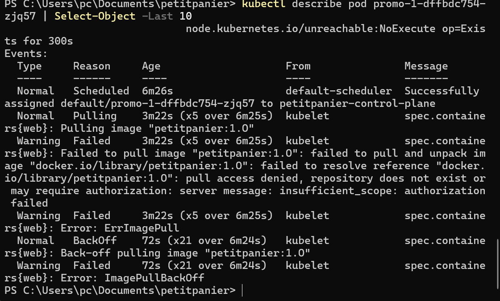

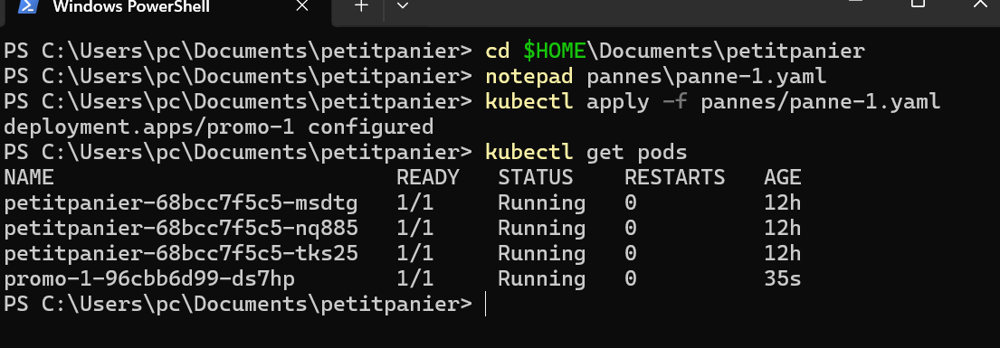

Preuves promo-2 :

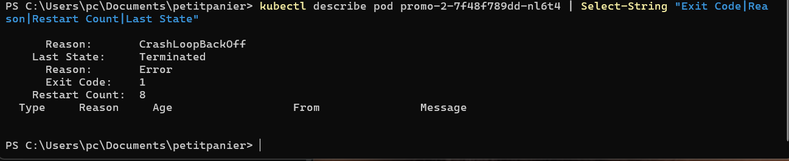

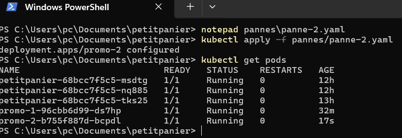

Preuves promo-3 :

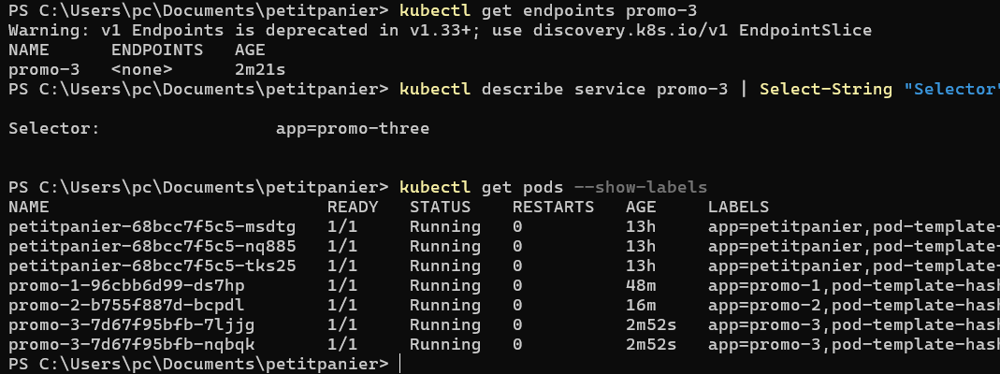

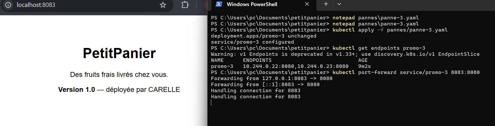

6.2 (--previous) : Sans --previous, on lit les logs de l'instance actuelle, qui vient d'être relancée et peut être vide. --previous affiche les logs de l'instance précédente, celle qui a planté. Chez moi les logs n'étaient pas récupérables, j'ai donc utilisé describe.

6.3 (pourquoi Running mais inaccessible) : Running signifie que le conteneur tourne, pas qu'il reçoit du trafic. Le Service visait app=promo-three alors que les Pods portent app=promo-3 : aucun endpoint, donc aucun trafic.

## Palier 7

| Étape | Commande | Si échec |
|---|---|---|
| build | docker build -t petitpanier:2.0 . | L'image n'est pas créée, le pipeline s'arrête |
| test | docker compose ps (état healthy) | Le service est unhealthy, on ne publie pas |
| publish | kind load docker-image petitpanier:2.0 --name petitpanier | L'image n'arrive pas au cluster, le déploiement échoue |
| deploy | kubectl apply -f k8s/ | L'ancienne version reste en place |

7.1 : Un tag comme a1b2c3d identifie une version précise du code : on sait exactement ce qui tourne et on peut revenir à une version donnée. latest change à chaque build et ne dit pas quelle version c'est. Au 5.3, rollout undo m'a permis de revenir de la 2.0 à la 1.0 parce que les deux images avaient des tags distincts.

Workflow n8n : Webhook GitLab (déclencheur) -> IF statut = failed (condition) -> message Slack #petitpanier-ops (action : prévient l'équipe DevOps). Les identifiants (token Slack, secret du webhook) sont rangés dans les Credentials de n8n, jamais écrits dans le workflow ni dans les fichiers du dépôt.

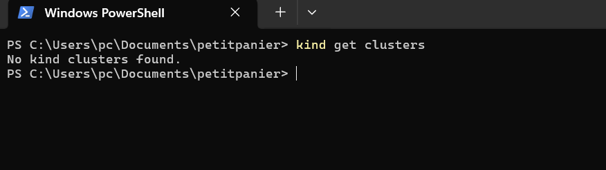
## Défis réalisés

Défi 2 : En relançant docker build sans rien modifier, l'étape COPY est marquée CACHED et le build prend 0,9 seconde. Docker réutilise les couches déjà construites tant que le Dockerfile et les fichiers copiés n'ont pas changé. L'image de base est simplement revérifiée (sans retéléchargement). Au build précédent, le COPY avait dû être refait parce que index.html avait été modifié.

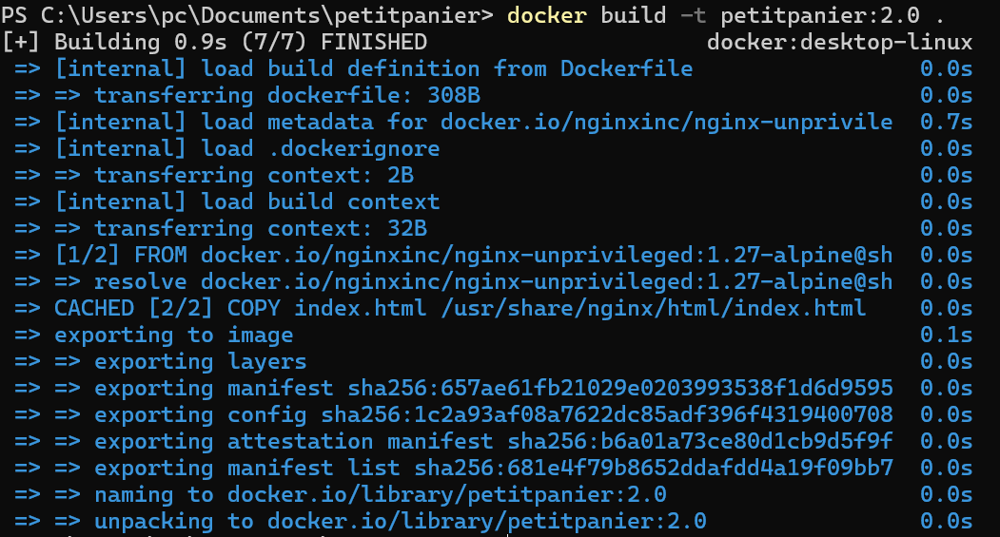

Défi 3 : J'ai ajouté un service stats (image nginx:alpine, port 8082:80) dans compose.yaml. La commande docker compose exec stats wget -qO- http://app:8080 affiche la page de mon site : stats joint app grâce au réseau créé par Compose, où chaque service est joignable par son nom.

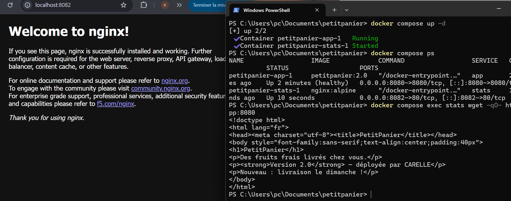

Défi 4 : Dans la section Events de kubectl describe pod, on voit Scheduled (le scheduler choisit le nœud petitpanier-control-plane), Pulled (l'image est déjà présente sur la machine grâce à kind load, rien n'est téléchargé), Created (le conteneur est créé) et Started (le conteneur démarre). On voit aussi un Warning "Readiness probe failed" (x2) juste après le démarrage : la sonde a testé nginx avant qu'il soit prêt. Le Pod est ensuite devenu Ready (1/1), donc ce n'est pas une panne durable.

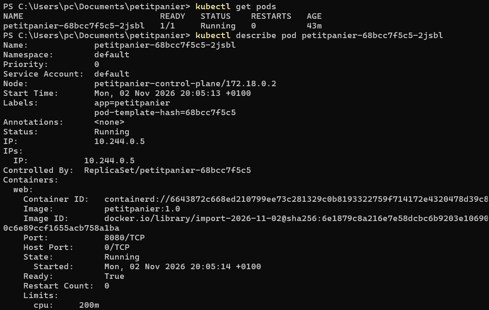

Défi 5 : J'ai remplacé replicas: 1 par replicas: 4 dans k8s/deployment.yaml, puis lancé kubectl apply -f k8s/ : Kubernetes a créé 4 Pods. Une équipe préfère modifier le fichier plutôt que taper kubectl scale, car le fichier est versionné dans Git : il garde l'état désiré, on peut le relire, le faire valider et le rejouer. Avec kubectl scale, le changement n'existe que dans le cluster et le fichier ne correspond plus à la réalité.

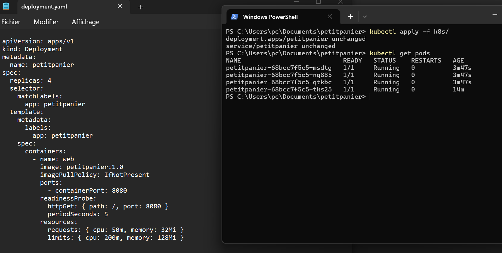

Défi 6 : En mettant path: /sante dans la readinessProbe, le nouveau Pod est Running mais 0/1 : la sonde échoue, donc Kubernetes ne le déclare pas prêt. Les 3 anciens Pods restent 1/1, donc le site reste disponible pendant la mise à jour. J'ai ensuite remis path: / et les Pods sont revenus à 1/1.

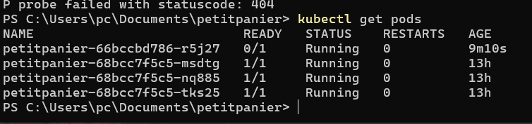

